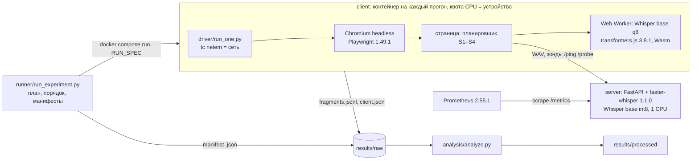

# asr-split-stand

Экспериментальный стенд к ВКР «Динамическое распределение вычислений между браузерным расширением
и сервером при распознавании речи с учётом производительности устройства и состояния сети».

Стенд отвечает на вопрос: **снижает ли адаптивный выбор места распознавания (браузер или сервер)
задержку получения текста по сравнению с простыми стратегиями, не ухудшая качество?**

| Стратегия | Правило |
|---|---|
| S1 | всегда локально (Whisper base в браузере, ONNX Runtime Web, Wasm) |
| S2 | всегда сервер (тот же Whisper base, faster-whisper) |
| S3 | сервер, если оценка канала > 5 Мбит/с |
| S4 | адаптивная: прогноз задержки для обеих сторон с учётом очереди, сети и откатом на локальное |

## Что нужно

- Docker с Compose v2 (проверено: Colima 0.x на macOS 26, VM 2 vCPU / 3 ГБ, Docker 29.5)
- [uv](https://docs.astral.sh/uv/) 0.13+ (Python 3.12 он скачает сам)
- Node.js 20+ — только для юнит-тестов планировщика
- ~4 ГБ свободного места под образы; интернет при первой сборке (модели и данные качаются по ревизиям)

## Быстрая проверка (≈ 15 минут)

```bash
git clone https://github.com/iskandario/asr-split-stand && cd asr-split-stand
git checkout v1.0
make data     # 80 фрагментов Golos, сверка SHA-256 с data/manifest.csv
make build    # образы сервера и клиента
make test     # юнит-тесты: планировщик (node --test) и анализ (pytest)
make smoke    # сервер отвечает, метрики есть, 2 коротких прогона проходят
```

## Полное воспроизведение

```bash
make aa          # A/A-тест: 10 прогонов S2 × N1 × D1, ≈ 20 мин
make experiment  # 348 прогонов, ≈ 15 ч; прерванный запуск продолжается с места остановки
make analyze     # results/processed: runs.csv, summary.csv, stats.md, графики
```

Или всё подряд: `make reproduce`.

Проверить только анализ, без железа, на моих сырых данных:

```bash
make analyze RAW=results/reference OUT=results/check
diff results/check/stats.md results/processed/stats.md   # должно совпасть
```

## Как устроен стенд



| Каталог | Что внутри |
|---|---|
| `configs/` | `base.yaml` — уровни факторов и профили сети; `experiment.yaml`, `aa.yaml`, `smoke.yaml`, `ci.yaml` — планы |
| `server/` | объект исследования, серверная сторона: FastAPI + faster-whisper, `uv.lock`, Dockerfile |
| `client/` | объект исследования, браузерная сторона: `web/` (планировщик, воркер), `driver/` (Playwright + netem), Dockerfile |
| `runner/` | оркестрация: план, рандомизация по сиду, запуск, манифест каждого прогона |
| `analysis/` | метрики прогона, bootstrap, Манн–Уитни, δ Клиффа, Холм, A/A, графики |
| `data/` | `prepare.py` и `manifest.csv` (SHA-256 и эталонные тексты); сами WAV не в git |
| `monitoring/` | конфиг Prometheus |
| `tests/` | юнит-тесты планировщика и анализа |
| `results/reference/` | сырые данные, на которых получены результаты отчёта |
| `docs/` | отчёты ПР3 и ПР4, схема |

## Факторы и метрики

- **Устройство** — квота CPU клиентского контейнера: D1 = 1 ядро, D2 = 0,5, D3 = 0,25.
- **Сеть** — `tc netem` на исходящем интерфейсе клиента: N1 50 Мбит/с, 20 мс; N2 8 Мбит/с, 80 ± 20 мс;
  N3 1 Мбит/с, 250 мс, 2 % потерь; N4 — смена N1 ↔ N3 каждые 20 с; N0 — сети нет (H₂).
- **Задержка фрагмента** — от момента, когда фрагмент речи закончился (фрагменты подаются в реальном времени),
  до получения текста на странице (`performance.now()`), мс. Единица анализа — **p95 за прогон**.
- **WER** — после нормализации (нижний регистр, ё→е, цифры→слова, без пунктуации), `jiwer`.

## Что пишется на каждый прогон (`results/raw`)

- `<run_id>.json` — манифест: параметры и уровни факторов, сид, порядок, git-коммит и «грязность»,
  ID образов, версия Docker и ресурсы VM, ОС и CPU хоста, питание от сети, время начала/конца,
  CPU сервера (среднее и пик по Prometheus), SHA-256 конфига и манифеста данных, полный разрешённый конфиг.
- `<run_id>.client.json` — версия Chromium и transformers.js, квота CPU из cgroup, `tc qdisc` в начале,
  моменты смены профиля N4, загрузка модели, трафик.
- `<run_id>.fragments.jsonl` — по фрагменту: где решено и где выполнено, прогнозы обеих сторон,
  оценка канала, отставание подачи от расписания, задержка, текст.
- `<run_id>.console.log` — консоль страницы.

## Известные ограничения

- «Устройство» эмулируется квотой CPU, а не разными ноутбуками; WebGPU в стенде не используется (headless в контейнере).
- netem ограничивает только исходящий трафик клиента (звук на сервер); ответы сервера — короткий текст.
- Модели на сторонах одинаковые по весам (Whisper base), но разные по рантайму и квантованию
  (ONNX q8 в браузере, CTranslate2 int8 на сервере), поэтому тексты могут немного отличаться.
