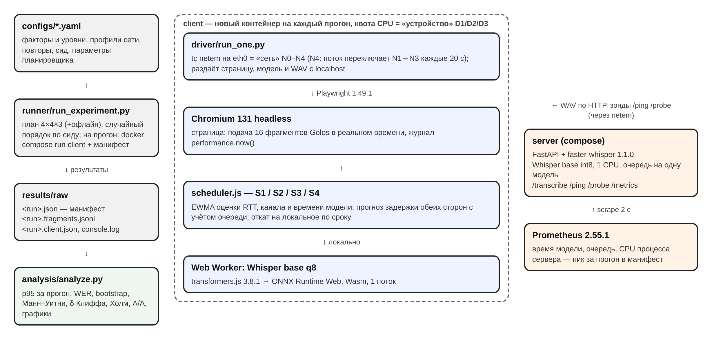

---
title_page:
  - {text: "Университет ИТМО", bold: true}
  - {text: "Проектирование и развертывание веб-решений в эко-системе Python", space_before: 6}
  - {text: "ОТЧЁТ", bold: true, size: 16, space_before: 110}
  - {text: "по практической работе № 4"}
  - {text: "«Реализация, тестирование и оценка экспериментального стенда»", bold: true}
  - {text: "Тема ВКР: «Динамическое распределение вычислений между браузерным расширением и сервером при распознавании речи с учётом производительности устройства и состояния сети»", space_before: 18}
  - {text: "Выполнил: Гарифуллин Искандар", align: right, space_before: 90}
  - {text: "Репозиторий: asr-split-stand, тег v1.0", align: right}
  - {text: "2026", space_before: 110}
---

[[TOC]]

# 1 Вопрос, гипотезы и изменения по сравнению с ПР3

**Исследовательский вопрос (ПР3).** Снижает ли адаптивное распределение распознавания речи между браузером и сервером задержку получения текста по сравнению с лучшей простой стратегией, не ухудшая качество распознавания?

- **H₀:** адаптивная стратегия S4 снижает p95 задержки менее чем на 20 % относительно лучшей простой стратегии того же условия (или не снижает).
- **H₁:** S4 снижает p95 задержки на 20 % и более, а WER растёт не более чем на 1 п. п.
- **H₂:** без сети S4 распознаёт 100 % фрагментов, S2 («всегда сервер») — 0 %.

Стратегии: S1 — всегда локально; S2 — всегда сервер; S3 — сервер, если оценка канала выше 5 Мбит/с; S4 — адаптивная (прогноз задержки обеих сторон с учётом очереди и сети, откат на локальное при превышении срока ответа сервера).

При реализации проект ПР3 изменён в нескольких местах (таблица 1). Все изменения вызваны ограничениями, выявленными при сборке и пилотных прогонах, и отражены в коде и конфигурации.

Table: Изменения проекта стенда по сравнению с ПР3
| Что было в ПР3 | Что сделано | Почему |
|---|---|---|
| Расширение Chrome MV3 с offscreen document | Веб-страница с тем же планировщиком и воркером распознавания в Chromium headless | Headless-браузер в контейнере не даёт стабильно поднять offscreen document; логика планировщика вынесена в модуль `scheduler.js` без зависимостей от DOM и одинакова для страницы и будущего расширения |
| Устройство: замедление CPU через Chrome DevTools Protocol | Квота CPU контейнера клиента (cgroups v2): 1 / 0,5 / 0,25 ядра | Замедление CDP действует на основной поток страницы, а модель работает в Web Worker; квота cgroups ограничивает все потоки браузера одинаково |
| WebGPU и Wasm | Только Wasm, 1 поток | WebGPU недоступен в headless Chromium в контейнере без GPU; фиксируется как ограничение |
| Отдельный контейнер-шейпер (nginx + netem) | netem на исходящем интерфейсе клиентского контейнера | Меньше компонентов, нет лишнего прокси в пути; исходящий трафик клиента — это и есть звук на сервер |
| cAdvisor для CPU сервера | Счётчик `process_cpu_seconds_total` сервера + Prometheus | cAdvisor в VM Colima требует привилегированных монтирований; процессный счётчик точнее для однопроцессного сервера |
| transformers.js 3.0.2, onnxruntime-web 1.20.1 | transformers.js 3.8.1 (onnxruntime-web 1.22-dev в составе) | В 3.0.x загрузчик wasm берётся с CDN; в 3.8.1 все файлы рантайма поставляются в пакете и кладутся в образ |
| 20 фрагментов, 10 повторов, 48 конфигураций | 16 фрагментов, 7 повторов, 48 конфигураций + 12 офлайн | Бюджет времени (~15 ч) при сохранении статистической силы: с односторонним тестом минимальный p после поправки Холма ≈ 0,0035 (при 5 повторах и двустороннем тесте он был бы ≈ 0,1 — значимость недостижима) |
| Длина ответа модели не ограничена | `max_new_tokens = 64` на обеих сторонах | В пилоте локальная модель зациклилась на одном фрагменте («ссссс…», 450 символов, 15,6 с); одинаковый предел — контролируемое условие |

# 2 Реализация стенда

## 2.1 Архитектура



Стенд состоит из долгоживущих сервисов Docker Compose (сервер распознавания и Prometheus) и клиентского контейнера, который раннер создаёт заново на каждый прогон (рисунок 1). Так каждый прогон начинается с чистого браузера, холодной загрузки локальной модели и заданной квоты CPU, а влияние прогонов друг на друга через кэши и память браузера исключено. Сервер, наоборот, между прогонами не пересоздаётся: в реальной системе он работает постоянно и прогрет; его состояние (модель в памяти) от прогона не зависит, а очередь к началу прогона пуста — это проверяется по метрикам.

Пять элементов стенда:

- **объект исследования** — планировщик со стратегиями S1–S4 и локальной моделью в браузере (клиент) и сервер распознавания;
- **воздействие** — 16 фрагментов русской речи из корпуса Golos, подаваемых в реальном времени (фрагмент i поступает в момент окончания речи), профили сети netem, квота CPU;
- **измерения** — журнал страницы по каждому фрагменту (`performance.now()`), метрики сервера в Prometheus, счётчик CPU сервера;
- **хранилище** — `results/raw`: сырые данные и манифест на каждый прогон;
- **анализ** — `analysis/analyze.py`.

## 2.2 Компоненты и версии

Table: Компоненты стенда
| Компонент | Технология и версия | Образ / окружение | Ресурсы |
|---|---|---|---|
| Сервер ASR | Python 3.12.16, FastAPI 0.115.14, uvicorn 0.32.1, faster-whisper 1.1.0 (CTranslate2 4.9.0), Whisper base int8 (Systran/faster-whisper-base @ebe41f7) | python:3.12-slim@sha256:5e2bdb1b…, uv 0.13.6, `uv sync --frozen` | 1 CPU, 1 ГБ, 1 поток модели |
| Клиент | Chromium 131.0.6778.33 headless shell (Playwright 1.49.1), transformers.js 3.8.1, Whisper base q8 (onnx-community/whisper-base @27a07b4), Wasm, 1 поток | python:3.12-slim-bookworm@sha256:935c3c5b…, node 22.12.0 (сборка), iproute2 | квота 1 / 0,5 / 0,25 CPU, 1,5 ГБ |
| Эмуляция сети | tc netem (iproute2, ядро VM 6.x) | внутри клиента, CAP_NET_ADMIN | — |
| Мониторинг | Prometheus 2.55.1, prometheus-fastapi-instrumentator 7 | prom/prometheus:v2.55.1 | 256 МБ |
| Раннер и анализ | Python 3.12, PyYAML, pandas 3.1, SciPy 1.18, jiwer, matplotlib, num2words | хост, `uv.lock` | — |
| Данные | Golos crowd test (bond005/sberdevices_golos_10h_crowd @e634b6b), 80 фрагментов 2–10 с, SHA-256 | `data/manifest.csv` | — |
| Хост | MacBook Air M1 (8 ядер, 16 ГБ), macOS 26.2, питание от сети | Colima: VM aarch64, 2 vCPU, 3 ГБ, Docker 29.5.2 | — |

Сервер и клиент используют одну и ту же модель (Whisper base, 74 млн параметров) с жадным декодированием, русским языком и пределом 64 токена; различаются только рантайм и квантование (CTranslate2 int8 на сервере, ONNX q8 в браузере). Это позволяет сравнивать место выполнения, а не разные модели.

## 2.3 Профили сети и устройства

Table: Уровни факторов
| Фактор | Уровень | Реализация |
|---|---|---|
| Сеть | N1 «хорошая» | netem: 50 Мбит/с, задержка 20 мс |
| | N2 «мобильная» | 8 Мбит/с, 80 ± 20 мс (нормальное распределение) |
| | N3 «плохая» | 1 Мбит/с, 250 мс, 2 % потерь |
| | N4 «нестабильная» | N1 и N3 сменяются каждые 20 с (поток в драйвере) |
| | N0 «нет сети» | 100 % потерь (только для H₂) |
| Устройство | D1 / D2 / D3 | квота CPU клиентского контейнера 1,0 / 0,5 / 0,25 ядра |
| Стратегия | S1–S4 | параметр страницы; порог S3 — 5 Мбит/с, запас S4 — 10 % |

netem применяется к исходящему трафику клиента: через него идёт звук на сервер (WAV 16 кГц, ~120 КБ на фрагмент 3,7 с) и зонды сети; ответы сервера — короткий JSON. Профиль задаётся до запуска браузера, поэтому прогрев проходит уже в условиях прогона. Статика страницы и модели отдаются с localhost и через netem не проходят.

## 2.4 Конфигурация, сырые данные и манифест

Все параметры вынесены в YAML: `configs/base.yaml` (уровни факторов, профили сети, параметры планировщика, тайм-ауты), `configs/experiment.yaml` (план: блоки, повторы, сид, рандомизация, число фрагментов, прогрев, пауза), `aa.yaml`, `smoke.yaml`, `ci.yaml`. Порядок прогонов перемешивается `random.Random(seed)`, поэтому план воспроизводим.

На каждый прогон сохраняются:

- `<run_id>.json` — манифест: параметры и уровни факторов, номер повтора и порядковый номер, сид, git-коммит и признак незакоммиченных изменений, ID образов (sha256), версия Docker, число vCPU и память VM, ядро, ОС и процессор хоста, питание от сети, время начала и конца (UTC), CPU сервера (среднее за прогон и пик по Prometheus), SHA-256 файла конфигурации и манифеста данных, полный разрешённый конфиг;
- `<run_id>.client.json` — версия Chromium и transformers.js, квота CPU из `/sys/fs/cgroup/cpu.max`, `tc qdisc` на старте, моменты переключения профиля N4, время загрузки модели, трафик (звук и зонды);
- `<run_id>.fragments.jsonl` — по фрагменту: плановое и фактическое время подачи, решение планировщика и причина, прогнозы обеих сторон, оценка канала и RTT, срок ответа сервера, где фактически выполнено, был ли откат, время модели, задержка, распознанный текст;
- `<run_id>.console.log` — консоль страницы.

## 2.5 Анализ

`analysis/analyze.py` читает сырые данные и строит всё из них, без ручных шагов. Единица наблюдения — прогон: из фрагментов прогона считается p95 задержки (основная метрика), p50, WER, доля распознанных за 10 с, доля фрагментов на сервере, трафик. Неудачный фрагмент (сервер не ответил, отката нет) цензурируется значением 30 с. WER считается после нормализации: нижний регистр, «ё» → «е», числа → слова (num2words), без пунктуации.

Сравнения: медиана p95 по повторам с 95 % bootstrap-интервалом (5000 выборок); для H₁ в каждом из 12 условий «сеть × устройство» S4 сравнивается с лучшей простой стратегией этого условия: относительная разница медиан с bootstrap-интервалом, односторонний тест Манна–Уитни (направление задано в ПР3) с поправкой Холма, δ Клиффа как размер эффекта. Графики: boxplot с точками отдельных прогонов, ECDF задержек, тепловая карта проигрыша лучшей стратегии, стабильность во времени, A/A, хронология решений S4.

# 3 Воспроизведение

Полная инструкция — в `README.md`. Нужны Docker с Compose v2, uv и (для юнит-тестов планировщика) Node.js 20+.

```
git clone <repo> asr-split-stand && cd asr-split-stand && git checkout v1.0
make data        # 80 фрагментов Golos, сверка SHA-256
make build       # образы сервера и клиента; модели скачиваются по ревизиям
make test        # 10 юнит-тестов планировщика (node --test) и 8 тестов анализа/раннера (pytest)
make smoke       # сервер отвечает, метрики собираются, 2 коротких прогона
make aa          # A/A-тест, ~20 мин
make experiment  # 348 прогонов, ~15 ч; прерванный запуск продолжается
make analyze     # results/processed: таблицы, stats.md, графики
```

Проверить анализ без железа: `make analyze RAW=results/reference OUT=results/check` — на сырых данных из репозитория должны получиться те же таблицы. Сокращённый эксперимент автоматически выполняется в GitHub Actions (`.github/workflows/stand.yml`, конфигурация `configs/ci.yaml`).

Проверяющий узнаёт, что его прогон выполнен на том же окружении, по манифесту: коммит и тег, ID образов, версия Chromium и transformers.js, SHA-256 конфигурации и данных, параметры VM — всё это сравнивается с манифестами в `results/reference`.

# 4 Тестирование стенда

[[STAND_TESTS]]

# 5 Результаты эксперимента

[[RESULTS]]

# 6 Оценка результатов и сравнение со статьями

[[EVALUATION]]

# 7 Угрозы валидности и ограничения

[[THREATS]]

# 8 Выводы и план развития стенда

[[CONCLUSIONS]]

# Ответы на вопросы для самопроверки

[[SELFCHECK]]

# Список литературы

1. Kang Y., Hauswald J., Gao C. et al. Neurosurgeon: Collaborative Intelligence Between the Cloud and Mobile Edge // ASPLOS '17. — ACM, 2017. — P. 615–629. — DOI: 10.1145/3037697.3037698.
2. Laskaridis S., Venieris S. I., Almeida M. et al. SPINN: Synergistic Progressive Inference of Neural Networks over Device and Cloud // MobiCom '20. — ACM, 2020. — DOI: 10.1145/3372224.3419194.
3. Wang Q., Jiang S., Chen Z. et al. Anatomizing Deep Learning Inference in Web Browsers // ACM TOSEM. — 2025. — Vol. 34, No. 2. — Art. 47. — DOI: 10.1145/3688843.
4. Jia F., Jiang S., Cao T. et al. Empowering In-Browser Deep Learning Inference on Edge Devices with Just-in-Time Kernel Optimizations // MobiSys '24. — ACM, 2024. — DOI: 10.1145/3643832.3661892.
5. Radford A., Kim J. W., Xu T. et al. Robust Speech Recognition via Large-Scale Weak Supervision // ICML 2023. — PMLR, 2023. — Vol. 202. — P. 28492–28518.
6. Chakravarty A. Deep Learning Models in Speech Recognition: Measuring GPU Energy Consumption, Impact of Noise and Model Quantization for Edge Deployment. — arXiv:2405.01004, 2024.
7. Karpov N., Denisenko A., Minkin F. Golos: Russian Dataset for Speech Research // Interspeech 2021. — ISCA, 2021.
8. Artifact Review and Badging — Current. Version 1.1 // ACM. — URL: https://www.acm.org/publications/policies/artifact-review-and-badging-current.
9. Kohavi R., Tang D., Xu Y. Trustworthy Online Controlled Experiments. — Cambridge University Press, 2020.
10. Cliff N. Dominance Statistics: Ordinal Analyses to Answer Ordinal Questions // Psychological Bulletin. — 1993. — Vol. 114, No. 3. — P. 494–509.
11. Holm S. A Simple Sequentially Rejective Multiple Test Procedure // Scandinavian Journal of Statistics. — 1979. — Vol. 6, No. 2. — P. 65–70.
