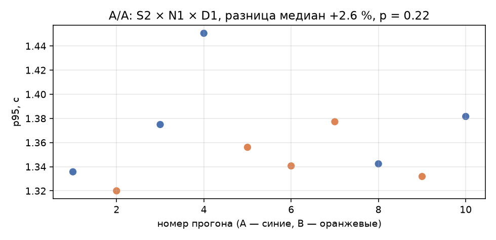
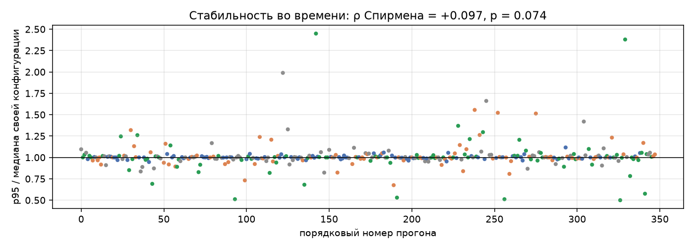
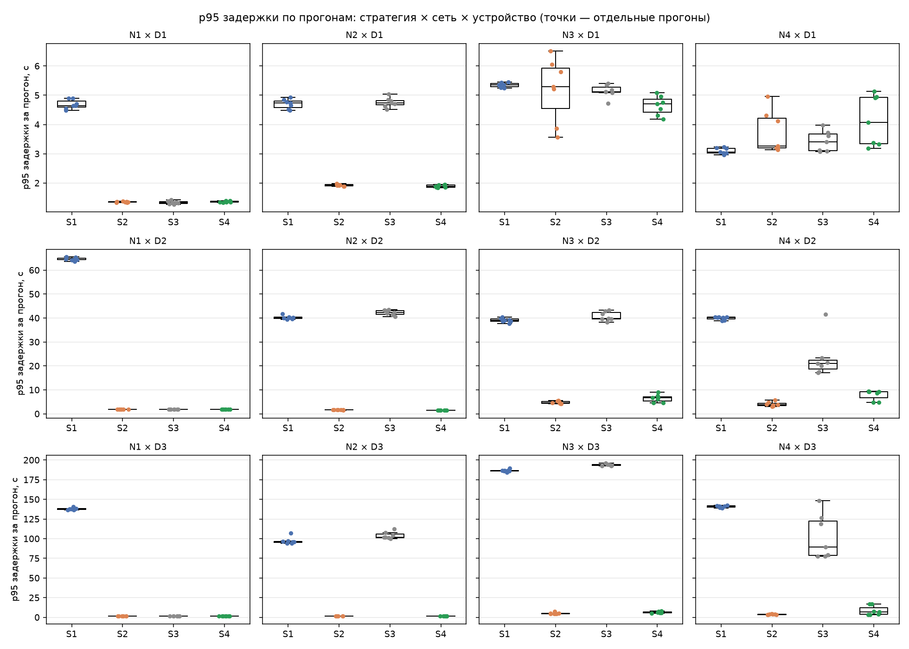
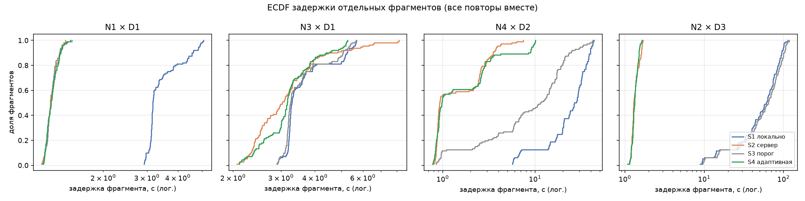
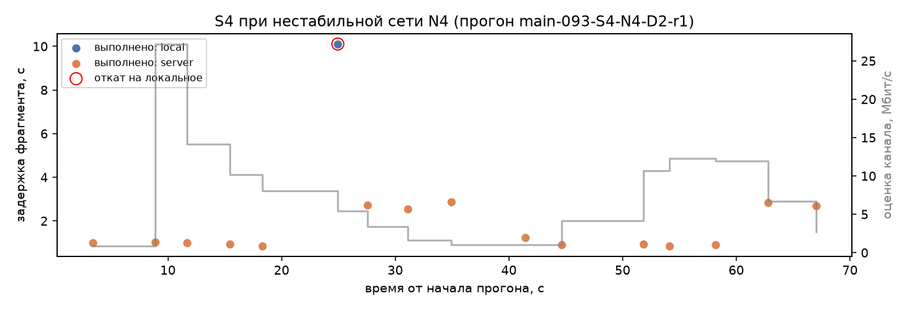
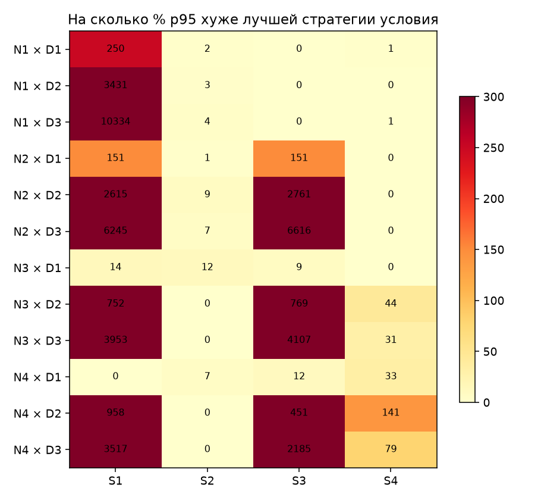
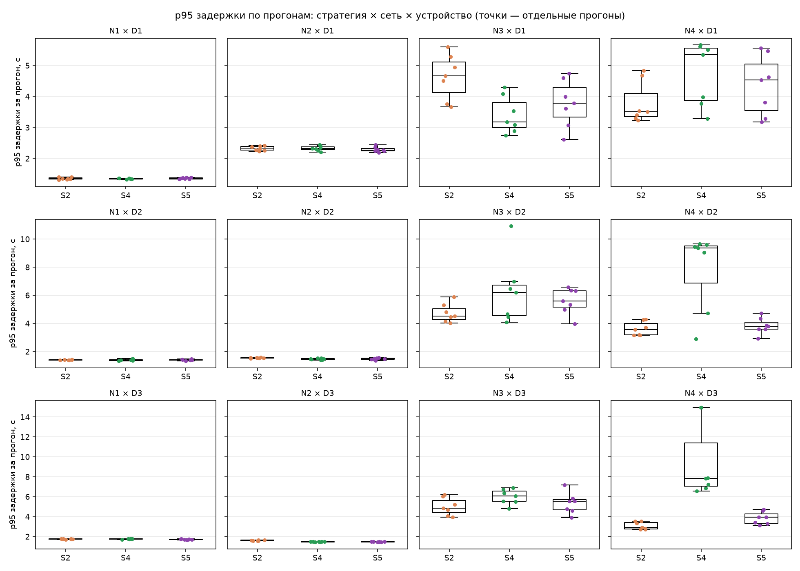
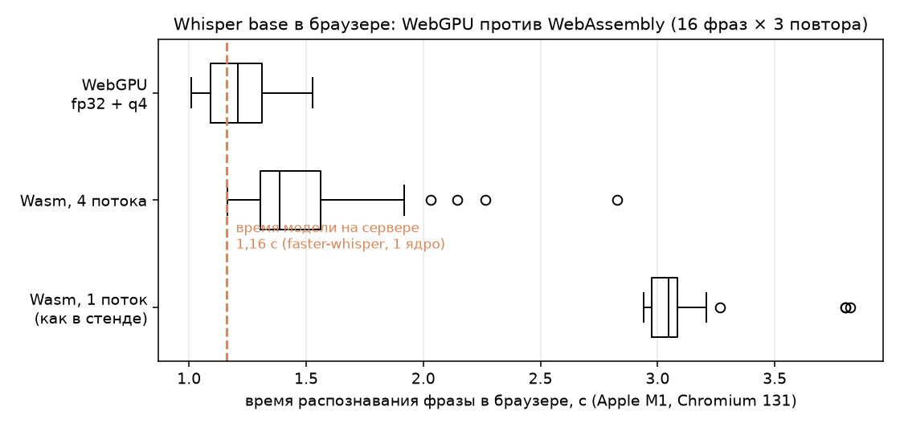

---
title_page:
  - {text: "Университет ИТМО", bold: true}
  - {text: "Проектирование и развертывание веб-решений в эко-системе Python", space_before: 6}
  - {text: "ОТЧЁТ", bold: true, size: 16, space_before: 110}
  - {text: "по практической работе № 4"}
  - {text: "«Реализация, тестирование и оценка экспериментального стенда»", bold: true}
  - {text: "Тема ВКР: «Динамическое распределение вычислений между браузерным расширением и сервером при распознавании речи с учётом производительности устройства и состояния сети»", space_before: 18}
  - {text: "Выполнил: Гарифуллин Искандар", align: right, space_before: 90}
  - {text: "Репозиторий: github.com/iskandario/asr-split-stand, тег v1.0", align: right}
  - {text: "2026", space_before: 110}
---

[[TOC]]

# 1 Вопрос, гипотезы и изменения по сравнению с ПР3

**Исследовательский вопрос (ПР3).** Снижает ли адаптивное распределение распознавания речи между браузером и сервером задержку получения текста по сравнению с лучшей простой стратегией, не ухудшая качество распознавания?

- **H₀:** адаптивная стратегия S4 снижает p95 задержки менее чем на 20 % относительно лучшей простой стратегии того же условия (или не снижает).
- **H₁:** S4 снижает p95 задержки на 20 % и более, а WER растёт не более чем на 1 п. п.
- **H₂:** без сети S4 распознаёт 100 % фрагментов, S2 («всегда сервер») — 0 %.

Стратегии: S1 — всегда локально; S2 — всегда сервер; S3 — сервер, если оценка канала выше 5 Мбит/с; S4 — адаптивная (прогноз задержки обеих сторон с учётом очереди и сети, откат на локальное при превышении срока ответа сервера).

При реализации проект ПР3 изменён в нескольких местах (таблица 1). Все изменения вызваны ограничениями, выявленными при сборке и пилотных прогонах, и отражены в коде и конфигурации.

Table: Изменения проекта стенда по сравнению с ПР3
| Что было в ПР3 | Что сделано | Почему |
|---|---|---|
| Расширение Chrome MV3 с offscreen document | Веб-страница с тем же планировщиком и воркером распознавания в Chromium headless | Headless-браузер в контейнере не даёт стабильно поднять offscreen document; логика планировщика вынесена в модуль `scheduler.js` без зависимостей от DOM и одинакова для страницы и будущего расширения |
| Устройство: замедление CPU через Chrome DevTools Protocol | Квота CPU контейнера клиента (cgroups v2): 1 / 0,5 / 0,25 ядра | Замедление CDP действует на основной поток страницы, а модель работает в Web Worker; квота cgroups ограничивает все потоки браузера одинаково |
| WebGPU и Wasm | Только Wasm, 1 поток | WebGPU недоступен в headless Chromium в контейнере без GPU; фиксируется как ограничение |
| Отдельный контейнер-шейпер (nginx + netem) | netem на исходящем интерфейсе клиентского контейнера | Меньше компонентов, нет лишнего прокси в пути; исходящий трафик клиента — это и есть звук на сервер |
| cAdvisor для CPU сервера | Счётчик `process_cpu_seconds_total` сервера + Prometheus | cAdvisor в VM Colima требует привилегированных монтирований; процессный счётчик точнее для однопроцессного сервера |
| transformers.js 3.0.2, onnxruntime-web 1.20.1 | transformers.js 3.8.1 (onnxruntime-web 1.22-dev в составе) | В 3.0.x загрузчик wasm берётся с CDN; в 3.8.1 все файлы рантайма поставляются в пакете и кладутся в образ |
| 20 фрагментов, 10 повторов, 48 конфигураций | 16 фрагментов, 7 повторов, 48 конфигураций + 12 офлайн | Бюджет времени (~15 ч) при сохранении статистической силы: с односторонним тестом минимальный p после поправки Холма ≈ 0,0035 (при 5 повторах и двустороннем тесте он был бы ≈ 0,1 — значимость недостижима) |
| Длина ответа модели не ограничена | `max_new_tokens = 64` на обеих сторонах | В пилоте локальная модель зациклилась на одном фрагменте («ссссс…», 450 символов, 15,6 с); одинаковый предел — контролируемое условие |
| Эксперимент на ноутбуке, случайный порядок всех прогонов | Раннеры GitHub Actions, блочный план: условие «сеть × устройство» — отдельная машина, внутри блока стратегии в случайном порядке | Полный план занял бы на ноутбуке ~15 ч непрерывной работы; блоки выполняются параллельно (~1,5 ч), а все сравнения стратегий идут внутри блока, т. е. на одном железе |

# 2 Реализация стенда

## 2.1 Архитектура


Стенд состоит из долгоживущих сервисов Docker Compose (сервер распознавания и Prometheus) и клиентского контейнера, который раннер создаёт заново на каждый прогон (рисунок 1). Так каждый прогон начинается с чистого браузера, холодной загрузки локальной модели и заданной квоты CPU, а влияние прогонов друг на друга через кэши и память браузера исключено. Сервер, наоборот, между прогонами не пересоздаётся: в реальной системе он работает постоянно и прогрет; его состояние (модель в памяти) от прогона не зависит, а очередь к началу прогона пуста — это проверяется по метрикам.

Пять элементов стенда:

- **объект исследования** — планировщик со стратегиями S1–S4 и локальной моделью в браузере (клиент) и сервер распознавания;
- **воздействие** — 16 фрагментов русской речи из корпуса Golos, подаваемых в реальном времени (фрагмент i поступает в момент окончания речи), профили сети netem, квота CPU;
- **измерения** — журнал страницы по каждому фрагменту (`performance.now()`), метрики сервера в Prometheus, счётчик CPU сервера;
- **хранилище** — `results/raw`: сырые данные и манифест на каждый прогон;
- **анализ** — `analysis/analyze.py`.

## 2.2 Компоненты и версии

Table: Компоненты стенда
| Компонент | Технология и версия | Образ / окружение | Ресурсы |
|---|---|---|---|
| Сервер ASR | Python 3.12.16, FastAPI 0.115.14, uvicorn 0.32.1, faster-whisper 1.1.0 (CTranslate2 4.9.0), Whisper base int8 (Systran/faster-whisper-base @ebe41f7) | python:3.12-slim@sha256:5e2bdb1b…, uv 0.13.6, `uv sync --frozen` | 1 CPU, 1 ГБ, 1 поток модели |
| Клиент | Chromium 131.0.6778.33 headless shell (Playwright 1.49.1), transformers.js 3.8.1, Whisper base q8 (onnx-community/whisper-base @27a07b4), Wasm, 1 поток | python:3.12-slim-bookworm@sha256:935c3c5b…, node 22.12.0 (сборка), iproute2 | квота 1 / 0,5 / 0,25 CPU, 1,5 ГБ |
| Эмуляция сети | tc netem (iproute2, ядро VM 6.x) | внутри клиента, CAP_NET_ADMIN | — |
| Мониторинг | Prometheus 2.55.1, prometheus-fastapi-instrumentator 7 | prom/prometheus:v2.55.1 | 256 МБ |
| Раннер и анализ | Python 3.12, PyYAML, pandas 3.1, SciPy 1.18, jiwer, matplotlib, num2words | хост, `uv.lock` | — |
| Данные | Golos crowd test (bond005/sberdevices_golos_10h_crowd @e634b6b), 80 фрагментов 2–10 с, SHA-256 | `data/manifest.csv` | — |
| Хост эксперимента | Раннеры GitHub Actions ubuntu-24.04: 4 vCPU, 16 ГБ, ядро 7.0 (Azure/AWS), Docker 28.0.4; процессор по блокам — AMD EPYC 9V74 / 9V45 / 7763 или Intel Xeon 6975P (фиксируется в манифесте) | x86_64 | — |
| Хост разработки и пилота | MacBook Air M1, macOS 26.2 | Colima: VM aarch64, 2 vCPU, 3 ГБ, Docker 29.5.2 | — |

Сервер и клиент используют одну и ту же модель (Whisper base, 74 млн параметров) с жадным декодированием, русским языком и пределом 64 токена; различаются только рантайм и квантование (CTranslate2 int8 на сервере, ONNX q8 в браузере). Это позволяет сравнивать место выполнения, а не разные модели.

## 2.3 Профили сети и устройства

Table: Уровни факторов
| Фактор | Уровень | Реализация |
|---|---|---|
| Сеть | N1 «хорошая» | netem: 50 Мбит/с, задержка 20 мс |
| | N2 «мобильная» | 8 Мбит/с, 80 ± 20 мс (нормальное распределение) |
| | N3 «плохая» | 1 Мбит/с, 250 мс, 2 % потерь |
| | N4 «нестабильная» | N1 и N3 сменяются каждые 20 с (поток в драйвере) |
| | N0 «нет сети» | 100 % потерь (только для H₂) |
| Устройство | D1 / D2 / D3 | квота CPU клиентского контейнера 1,0 / 0,5 / 0,25 ядра |
| Стратегия | S1–S4 | параметр страницы; порог S3 — 5 Мбит/с, запас S4 — 10 % |

netem применяется к исходящему трафику клиента: через него идёт звук на сервер (WAV 16 кГц, ~120 КБ на фрагмент 3,7 с) и зонды сети; ответы сервера — короткий JSON. Профиль задаётся до запуска браузера, поэтому прогрев проходит уже в условиях прогона. Статика страницы и модели отдаются с localhost и через netem не проходят.

## 2.4 Конфигурация, сырые данные и манифест

Все параметры вынесены в YAML: `configs/base.yaml` (уровни факторов, профили сети, параметры планировщика, тайм-ауты), `configs/experiment.yaml` (план: блоки, повторы, сид, рандомизация, число фрагментов, прогрев, пауза), `aa.yaml`, `smoke.yaml`, `ci.yaml`. Порядок прогонов перемешивается `random.Random(seed)`, поэтому план воспроизводим.

На каждый прогон сохраняются:

- `<run_id>.json` — манифест: параметры и уровни факторов, номер повтора и порядковый номер, сид, git-коммит и признак незакоммиченных изменений, ID образов (sha256), версия Docker, число vCPU и память VM, ядро, ОС и процессор хоста, питание от сети, время начала и конца (UTC), CPU сервера (среднее за прогон и пик по Prometheus), SHA-256 файла конфигурации и манифеста данных, полный разрешённый конфиг;
- `<run_id>.client.json` — версия Chromium и transformers.js, квота CPU из `/sys/fs/cgroup/cpu.max`, `tc qdisc` на старте, моменты переключения профиля N4, время загрузки модели, трафик (звук и зонды);
- `<run_id>.fragments.jsonl` — по фрагменту: плановое и фактическое время подачи, решение планировщика и причина, прогнозы обеих сторон, оценка канала и RTT, срок ответа сервера, где фактически выполнено, был ли откат, время модели, задержка, распознанный текст;
- `<run_id>.console.log` — консоль страницы.

## 2.5 Анализ

`analysis/analyze.py` читает сырые данные и строит всё из них, без ручных шагов. Единица наблюдения — прогон: из фрагментов прогона считается p95 задержки (основная метрика), p50, WER, доля распознанных за 10 с, доля фрагментов на сервере, трафик. Неудачный фрагмент (сервер не ответил, отката нет) цензурируется значением 30 с. WER считается после нормализации: нижний регистр, «ё» → «е», числа → слова (num2words), без пунктуации.

Сравнения: медиана p95 по повторам с 95 % bootstrap-интервалом (5000 выборок); для H₁ в каждом из 12 условий «сеть × устройство» S4 сравнивается с лучшей простой стратегией этого условия: относительная разница медиан с bootstrap-интервалом, односторонний тест Манна–Уитни (направление задано в ПР3) с поправкой Холма, δ Клиффа как размер эффекта. Графики: boxplot с точками отдельных прогонов, ECDF задержек, тепловая карта проигрыша лучшей стратегии, стабильность во времени, A/A, хронология решений S4.

# 3 Воспроизведение

Полная инструкция — в `README.md`. Нужны Docker с Compose v2, uv и (для юнит-тестов планировщика) Node.js 20+.

```
git clone https://github.com/iskandario/asr-split-stand && cd asr-split-stand && git checkout v1.0
make data        # 80 фрагментов Golos, сверка SHA-256
make build       # образы сервера и клиента; модели скачиваются по ревизиям
make test        # 10 юнит-тестов планировщика (node --test) и 8 тестов анализа/раннера (pytest)
make smoke       # сервер отвечает, метрики собираются, 2 коротких прогона
make aa          # A/A-тест, ~20 мин
make experiment  # 348 прогонов, ~15 ч на одной машине; прерванный запуск продолжается
make analyze     # results/processed: таблицы, stats.md, графики
```

Полный эксперимент удобнее запускать в GitHub Actions: Actions → experiment → Run workflow (параметр `config`: `configs/experiment.yaml` для v1.0 или `configs/v11.yaml` для v1.1). Workflow собирает образы, публикует их в GHCR и запускает 12 блоков «сеть × устройство», офлайн-блок и A/A параллельно; сырые данные каждого блока и результаты анализа сохраняются как артефакты на 90 дней. Результаты отчёта получены запусками https://github.com/iskandario/asr-split-stand/actions/runs/43905794193 (v1.0) и https://github.com/iskandario/asr-split-stand/actions/runs/43937158895 (v1.1).

Проверить анализ без железа: `make analyze RAW=results/reference/v10 OUT=results/check` — на сырых данных из репозитория получаются те же таблицы. При каждом изменении кода GitHub Actions (`stand.yml`) собирает стенд, выполняет юнит-тесты, smoke-тест и сокращённый эксперимент (`configs/ci.yaml`).

Проверяющий узнаёт, что его прогон выполнен на том же окружении, по манифесту: коммит и тег, ID образов, версия Chromium и transformers.js, SHA-256 конфигурации и данных, параметры VM — всё это сравнивается с манифестами в `results/reference`.

# 4 Тестирование стенда

Перед основным экспериментом и по его данным проверено, что стенд измеряет корректно (таблица 4).

Table: Проверка стенда
| Проверка | Как | Результат | Вывод |
|---|---|---|---|
| Smoke-тест | `make smoke`: сервер отвечает на /health и /transcribe, метрики есть в Prometheus, проходят 2 коротких прогона | проходит локально и в CI при каждом изменении | стенд собирается и работает целиком |
| A/A-тест | 10 прогонов S2 × N1 × D1 на одной машине, случайное деление на группы A и B (сид) | медианы p95 1,37 и 1,34 с, разница +2,6 %, Манн–Уитни p = 0,22 | значимого различия нет |
| Шум стенда | коэффициент вариации p95 в A/A | 2,8 % | минимальный обнаружимый эффект ≈ 4,9 % (α = 0,05, мощность 80 %) — в 4 раза меньше порога H₁ (20 %) |
| Генератор не узкое место | отставание фактической подачи фрагмента от расписания (`ready_ms − sched_ms`) | p95 по прогонам: медиана 0,3 мс, максимум 92 мс | страница подаёт речь вовремя даже при квоте 0,25 ядра |
| Сервер не узкое место | CPU процесса сервера (лимит 1 ядро): среднее за прогон и пик по Prometheus | среднее ≤ 0,25 ядра, пик ≤ 0,89 | очередь на сервере не искажает задержку |
| Стабильность во времени | p95 прогона / медиана своей конфигурации против порядкового номера, ρ Спирмена | ρ = +0,10, p = 0,074 (v1.0); A/A: ρ = +0,26, p = 0,47 | значимого тренда нет |
| Повторяемость | второй независимый запуск того же стенда (v1.1) для стратегий S2 и S4 | ранговая корреляция p95 по условиям 0,89 (p < 10⁻⁸) | выводы воспроизводятся (раздел 5.4) |

{width=12}



Отдельно отмечено, что δ Клиффа в A/A равна +0,52 при p = 0,22: при пяти прогонах на группу оценка размера эффекта сама по себе неустойчива, поэтому вывод делается по совокупности — интервал, тест и абсолютная разница (2,6 % при шуме 2,8 %).

# 5 Результаты эксперимента

## 5.1 Обзор

Эксперимент v1.0: 336 прогонов основного блока (4 стратегии × 4 сети × 3 устройства × 7 повторов), 12 прогонов без сети и 10 прогонов A/A; ни одного неудачного прогона. В каждом прогоне 16 фраз Golos (≈ 60 с речи) подавались в реальном времени. Медианы p95 по повторам — в таблице 5, распределения — на рисунках 4–5.

Table: Медиана p95 задержки по 7 повторам, с [95 % bootstrap-интервал]
| Сеть × устройство | S1 локально | S2 сервер | S3 порог | S4 адаптивная |
|---|---|---|---|---|
| N1 × D1 | 4,65 [4,54; 4,89] | 1,35 [1,34; 1,36] | **1,33** [1,29; 1,37] | 1,35 [1,34; 1,39] |
| N1 × D2 | 64,40 [64,27; 65,34] | 1,87 [1,84; 1,88] | **1,82** [1,79; 1,86] | **1,82** [1,81; 1,86] |
| N1 × D3 | 137,48 [136,72; 138,30] | 1,37 [1,31; 1,38] | **1,32** [1,31; 1,34] | 1,33 [1,31; 1,35] |
| N2 × D1 | 4,74 [4,51; 4,85] | 1,91 [1,89; 1,95] | 4,74 [4,63; 4,84] | **1,89** [1,85; 1,94] |
| N2 × D2 | 40,18 [39,62; 40,33] | 1,61 [1,58; 1,65] | 42,35 [41,31; 43,20] | **1,48** [1,46; 1,51] |
| N2 × D3 | 96,10 [94,15; 96,90] | 1,62 [1,56; 1,62] | 101,73 [100,92; 107,36] | **1,51** [1,48; 1,54] |
| N3 × D1 | 5,36 [5,26; 5,43] | 5,28 [3,87; 6,05] | 5,12 [5,08; 5,35] | **4,71** [4,31; 4,96] |
| N3 × D2 | 39,02 [38,66; 39,87] | **4,58** [4,22; 5,32] | 39,81 [39,62; 42,98] | 6,60 [4,56; 7,53] |
| N3 × D3 | 186,48 [185,88; 186,80] | **4,60** [4,25; 5,21] | 193,57 [192,58; 194,45] | 6,01 [5,36; 7,49] |
| N4 × D1 | **3,05** [3,02; 3,20] | 3,26 [3,20; 4,30] | 3,40 [3,09; 3,73] | 4,07 [3,33; 4,94] |
| N4 × D2 | 40,21 [38,99; 40,38] | **3,80** [3,13; 4,71] | 20,93 [17,49; 23,29] | 9,14 [4,84; 9,24] |
| N4 × D3 | 141,24 [139,60; 141,84] | **3,90** [3,56; 3,94] | 89,23 [77,77; 126,67] | 7,00 [3,58; 16,65] |





Главные наблюдения:

- **Локальное распознавание на слабом устройстве не успевает за речью.** Whisper base в Wasm в одном потоке тратит в медиане 3,1 с на фразу при 1 ядре (RTF 0,8), 6,5 с при 0,5 ядра (RTF 1,7) и 12,8 с при 0,25 ядра (RTF 3,4); серверу на одном ядре нужно 1,2 с. Фразы прибывают раньше, чем распознаются предыдущие, очередь растёт, и p95 у S1 достигает 40–190 с. Это прямое следствие коэффициента реального времени, а не «медленный прогон».
- **Сервер почти везде выигрывает.** S2 проигрывает лучшей стратегии условия не более чем на 12 % ни в одном из 12 условий (таблица 7).
- **Статический порог (S3) опасен.** Порог 5 Мбит/с сравнивается с измеренной эффективной скоростью: на коротких загрузках (≈ 120 КБ) TCP не успевает разогнаться, и в мобильной сети N2 (номинально 8 Мбит/с) оценка составила 1,3 Мбит/с. S3 ни разу не отправил фразу на сервер в N2 и N3 и проиграл S2 в 9–63 раза на устройствах D2–D3.
- **S4 в стабильных сетях не хуже лучшей стратегии,** а в мобильной сети N2 на устройствах D2–D3 значимо быстрее S2 на 6–8 %. Но в плохой (N3 × D2, D3) и нестабильной (N4) сети S4 хуже S2 на 31–141 %.
- **Без сети** S1, S3 и S4 распознали 100 % фраз, S2 — 0 % (таблица 8).
- **Качество не зависит от места выполнения:** WER всех локально распознанных фраз 58,6 %, на сервере 58,3 %.

## 5.2 Проверка гипотезы H₁

Для каждого условия S4 сравнивалась с лучшей простой стратегией этого условия (таблица 6): относительная разница медиан p95 с bootstrap-интервалом, односторонний тест Манна–Уитни (направление «S4 быстрее» задано в ПР3) с поправкой Холма на 12 сравнений, δ Клиффа.

Table: S4 против лучшей простой стратегии условия (v1.0)
| Условие | Лучшая простая | p95 S4, с | p95 лучшей, с | Δ, % [95 % ДИ] | p₁ (Холм) | δ Клиффа | ΔWER, п. п. |
|---|---|---|---|---|---|---|---|
| N1 × D1 | S3 | 1,35 | 1,33 | +1 [−2; +6] | 1,000 | +0,47 (средний) | 0,0 |
| N1 × D2 | S3 | 1,82 | 1,82 | 0 [−2; +3] | 1,000 | +0,10 (пренебрежимый) | 0,0 |
| N1 × D3 | S3 | 1,33 | 1,32 | +1 [−2; +3] | 1,000 | +0,06 (пренебрежимый) | 0,0 |
| N2 × D1 | S2 | 1,89 | 1,91 | −1 [−5; +2] | 1,000 | −0,35 (средний) | 0,0 |
| N2 × D2 | S2 | 1,48 | 1,61 | **−8** [−11; −5] | **0,003** | −1,00 (большой) | 0,0 |
| N2 × D3 | S2 | 1,51 | 1,62 | **−6** [−9; −2] | **0,013** | −0,92 (большой) | 0,0 |
| N3 × D1 | S3 | 4,71 | 5,12 | **−8** [−17; −2] | **0,035** | −0,84 (большой) | +1,2 |
| N3 × D2 | S2 | 6,60 | 4,58 | +44 [−6; +70] | 1,000 | +0,67 (большой) | 0,0 |
| N3 × D3 | S2 | 6,01 | 4,60 | +31 [+6; +72] | 1,000 | +0,76 (большой) | 0,0 |
| N4 × D1 | S1 | 4,07 | 3,05 | +33 [+5; +64] | 1,000 | +0,92 (большой) | −2,5 |
| N4 × D2 | S2 | 9,14 | 3,80 | +141 [+22; +195] | 1,000 | +0,88 (большой) | −1,2 |
| N4 × D3 | S2 | 7,00 | 3,90 | +79 [−9; +365] | 1,000 | +0,51 (большой) | 0,0 |

**H₁ отвергается.** Ни в одном условии верхняя граница интервала не опустилась ниже −20 %: в трёх условиях S4 значимо быстрее, но лишь на 6–8 %, а в пяти — медленнее. Критерий фальсификации из ПР3 («в большинстве условий интервал не уходит ниже −20 %») выполнен. Условие на качество при этом соблюдено: |ΔWER| ≤ 2,5 п. п. там, где S4 и лучшая стратегия распознавали в разных местах, и 0 там, где обе работали на сервере.

**Причина проигрыша S4 — откат на локальное распознавание.** S4 обрывает запрос, если сервер не ответил за 2,5 прогноза, и распознаёт фразу локально. В плохой и нестабильной сети это случается 1–2 раза на прогон, а локально на устройстве D2 фраза распознаётся 9–11 с, тогда как сервер ответил бы через 3–4 с. При 16 фразах одна такая фраза и определяет p95 (рисунок 6). Оценка канала у S4 при этом работает правильно: на рисунке видно, как она падает при переключении N1 → N3 и восстанавливается.



## 5.3 Устойчивость стратегий и H₂

Table: Проигрыш лучшей стратегии условия по медиане p95 (v1.0)
| Стратегия | Максимальный проигрыш | Средний проигрыш | Худшее условие |
|---|---|---|---|
| S1 локально | в 104 раза | в 28 раз | N1 × D3 |
| S2 сервер | 12 % | 4 % | N3 × D1 |
| S3 порог | в 67 раз | в 15 раз | N2 × D3 |
| S4 адаптивная | 141 % | 28 % | N4 × D2 |

{width=12}

Table: H₂ — доля распознанных фраз без сети (N0 × D1, 3 прогона)
| S1 | S2 | S3 | S4 |
|---|---|---|---|
| 100 % | 0 % | 100 % | 100 % |

**H₂ подтверждается**: без сети S4 распознала все фразы, S2 — ни одной. По сравнению с худшей простой стратегией условия S4 снижает p95 на 60–99 % в 10 из 12 условий (ещё в одном — на 12 %, в N4 × D1 уступает 20 %); именно в этом смысле адаптивность полезна — она защищает от катастрофических ошибок S1 и S3, хотя в v1.0 не превосходит хорошо выбранную фиксированную стратегию.

## 5.4 Исправление по результатам: S5 (v1.1)

Анализ v1.0 показал, что проигрыш S4 вызван обрывом запроса к серверу и откатом на медленное локальное распознавание. На этой основе сделана стратегия **S5**: решение «где распознавать» принимается так же, как в S4, но после срока (2,5 прогноза) запрос к серверу **не обрывается** — параллельно запускается локальное распознавание (если локальная модель свободна), и засчитывается ответ, пришедший первым (хеджирование запросов, Dean и Barroso [12]). Без сети S5, как и S4, сразу распознаёт локально. Изменение — 40 строк в `client/web/main.js`, логика выбора (`scheduler.js`) не менялась; добавлены 2 юнит-теста.

Повторный эксперимент v1.1 выполнен тем же стендом на раннерах GitHub (запуск 43937158895): стратегии S2, S4 и S5 × 4 сети × 3 устройства × 7 повторов (252 прогона) и S5 без сети (3 прогона), без неудачных прогонов.

Table: Медиана p95 задержки в v1.1, с [95 % bootstrap-интервал]
| Сеть × устройство | S2 сервер | S4 адаптивная | S5 адаптивная + хеджирование |
|---|---|---|---|
| N1 × D1 | 1,35 [1,32; 1,39] | 1,35 [1,33; 1,36] | 1,36 [1,34; 1,38] |
| N1 × D2 | 1,40 [1,39; 1,42] | 1,39 [1,35; 1,46] | 1,40 [1,38; 1,45] |
| N1 × D3 | 1,74 [1,73; 1,76] | 1,75 [1,73; 1,78] | 1,69 [1,68; 1,73] |
| N2 × D1 | 2,30 [2,26; 2,40] | 2,33 [2,26; 2,41] | 2,27 [2,24; 2,36] |
| N2 × D2 | 1,53 [1,53; 1,55] | 1,48 [1,42; 1,52] | 1,48 [1,43; 1,54] |
| N2 × D3 | 1,60 [1,57; 1,65] | 1,47 [1,43; 1,49] | 1,47 [1,46; 1,50] |
| N3 × D1 | 4,66 [3,75; 5,28] | 3,17 [2,89; 4,09] | 3,79 [3,07; 4,60] |
| N3 × D2 | 4,51 [4,13; 5,30] | 6,20 [4,45; 6,98] | 5,58 [4,98; 6,34] |
| N3 × D3 | 4,84 [4,06; 6,05] | 6,06 [5,50; 6,72] | 5,54 [4,59; 5,83] |
| N4 × D1 | 3,50 [3,29; 4,68] | 5,34 [3,76; 5,61] | 4,53 [3,29; 5,47] |
| N4 × D2 | 3,58 [3,16; 4,26] | 9,36 [4,72; 9,59] | **3,81** [3,59; 4,35] |
| N4 × D3 | 2,92 [2,72; 3,52] | 7,85 [6,85; 14,94] | **3,93** [3,27; 4,60] |

Table: S5 против S4 — эффект хеджирования (односторонний Манн–Уитни, Холм на 12 сравнений)
| Условие | p95 S5, с | p95 S4, с | Δ, % [95 % ДИ] | p₁ (Холм) | δ Клиффа |
|---|---|---|---|---|---|
| N3 × D2 | 5,58 | 6,20 | −10 [−29; +42] | 1,000 | −0,10 |
| N3 × D3 | 5,54 | 6,06 | −9 [−29; +5] | 1,000 | −0,35 (средний) |
| N4 × D1 | 4,53 | 5,34 | −15 [−40; +37] | 1,000 | −0,27 (малый) |
| N4 × D2 | 3,81 | 9,36 | **−59** [−63; −18] | 0,144 | −0,71 (большой) |
| N4 × D3 | 3,93 | 7,85 | **−50** [−77; −36] | **0,003** | −1,00 (большой) |
| остальные 7 условий | | | от −3 до +1 (кроме N3 × D1: +19 [−13; +49]) | 1,000 | |



Результаты v1.1:

- **Хеджирование устранило главный провал адаптивной стратегии.** В нестабильной сети p95 снизился на 50–59 % (N4 × D3 — значимо после поправки Холма, p = 0,003; N4 × D2 — большой эффект, δ = −0,71, но после поправки p = 0,14). Максимальный проигрыш лучшей стратегии условия сократился со 169 % у S4 до 35 % у S5, средний — с 38 % до 11 %. В стабильных сетях S5 ведёт себя как S4 (разница в пределах ±3 %).
- **Механизм оказался проще, чем ожидалось.** Хеджирование сработало в 33 из 1392 фраз, и ни разу локальная модель не ответила первой: на устройствах D1–D3 Wasm-распознавание (3–13 с) медленнее даже опоздавшего сервера. Весь выигрыш дало то, что запрос к серверу больше не обрывается. Параллельный локальный запуск станет полезен, когда локальная сторона быстрее, — например, с WebGPU (раздел 5.5).
- **S5 против S2 (всегда сервер):** значимо быстрее в N2 × D3 (−8 %, p = 0,003), в остальных условиях разница незначима, а в плохой сети N3 × D2 S5 медленнее на 24 %. H₁ (−20 % относительно лучшей простой стратегии) для S5 также не подтверждается; H₂ подтверждается: без сети S5 распознала 100 % фраз.
- **Повторяемость.** Для S2 и S4, измеренных в обоих запусках, ранговая корреляция медиан p95 по 12 условиям составила 0,89 (p < 10⁻⁸). Абсолютные значения в отдельных условиях различаются до ±30 % — блоки двух запусков попали на разные процессоры раннеров (см. угрозы валидности), — но вывод «S4 проигрывает S2 в плохой и нестабильной сети» воспроизвёлся во всех пяти таких условиях (N3 × D2, N3 × D3, N4 × D1–D3).

## 5.5 WebGPU на реальном устройстве

Главное ограничение стенда — локальная сторона измерена только в WebAssembly с одним потоком: в контейнерах раннеров нет видеокарты. Для темы ВКР (веб-технологии) именно WebGPU — ключевая возможность браузера, поэтому выполнен дополнительный замер на реальном устройстве (`bench/webgpu`, одна команда `uv run python bench/webgpu/run_bench.py`): та же модель Whisper base, те же 16 фраз Golos, 2 фразы прогрева, 3 повтора, настоящий Chromium 131 с GPU на ноутбуке MacBook Air M1 (WebGPU-адаптер Apple, поддержка shader-f16, страница изолирована заголовками COOP/COEP). Сравнивались четыре режима ONNX Runtime Web (таблица 12, рисунок 9). Сырые данные — `results/reference/webgpu/`.

Table: Распознавание фразы в браузере на Apple M1 (48 измерений на режим)
| Режим | Веса | Медиана, с | p95, с | RTF | Ускорение | WER, % |
|---|---|---|---|---|---|---|
| Wasm, 1 поток (как в стенде) | q8 | 3,05 | 3,61 | 0,80 | 1,0× | 58,8 |
| Wasm, 4 потока | q8 | 1,39 | 2,11 | 0,36 | 2,2× | 58,8 |
| **WebGPU** | кодировщик fp32, декодировщик q4 | **1,21** | **1,48** | **0,32** | **2,5×** | **47,5** |
| WebGPU | fp16 | 2,19 | 2,25 | 0,58 | — | неработоспособен |
| *для сравнения: сервер, 1 ядро* | *int8* | *1,16* | | | | *58,3* |



Выводы замера:

- **WebGPU делает браузер сопоставимым с сервером.** На GPU ноутбука фраза распознаётся за 1,21 с — практически столько же, сколько модель работает на сервере (1,16 с), но без передачи звука по сети. Многопоточный Wasm даёт почти такой же выигрыш (2,2×) на многоядерном процессоре.
- **Ускорение меньше, чем «в разы» для крупных моделей** [3, 4]: Whisper base мала, а декодировщик порождает текст пошагово, и на каждом шаге GPU простаивает из-за накладных расходов запуска ядер. Выигрыш WebGPU должен расти с размером модели (small, medium).
- **Неожиданный результат по качеству.** WebGPU-вариант с кодировщиком в fp32 дал WER 47,5 % против 58,8 % у 8-битных весов, использованных в стенде на обеих сторонах. То есть 8-битное квантование кодировщика стоит около 11 п. п. WER на коротких русских командах — это уточняет вывод о нечувствительности качества к квантованию [6]: для маленькой модели и русского языка она не подтверждается. Заодно fp32-вариант не зацикливается на трудной фразе («ссссс…»).
- **fp16 на этом GPU неработоспособен:** модель выдаёт повторяющийся символ («К К К …») — переполнение в половинной точности. Это практический довод, почему планировщик в расширении должен проверять не только наличие WebGPU, но и работоспособность конкретного варианта модели.

**Что это значит для гипотезы H₁.** В плохой и нестабильной сети (N3, N4) p95 стратегии «всегда сервер» составлял 2,9–4,8 с, а распознавание через WebGPU на устройстве — 1,2–1,5 с. Адаптивная стратегия, которая в таких условиях выбирает локальное распознавание, на устройстве с WebGPU должна снижать p95 относительно лучшей фиксированной стратегии значительно больше чем на 20 %, а хеджирование S5 — получать выигрыш от второго исполнителя, а не только от отмены обрыва. Это **оценка**, а не измерение: проверка H₁ на устройствах с WebGPU — первая задача экспериментальной главы ВКР (клиент в браузере с GPU вместо headless-контейнера).

# 6 Оценка результатов и сравнение со статьями

Table: Сравнение с работами из ПР3
| Работа | Что сообщают авторы | Что получено на стенде | Согласие |
|---|---|---|---|
| Neurosurgeon [1] | адаптивное разбиение в среднем в 3,1 раза быстрее облака/устройства | в 10 из 12 условий S4 быстрее худшей простой стратегии на 60–99 % (в 2,5–100 раз), но не быстрее лучшей | порядок величин совпадает при сравнении с «неудачной» стратегией; при сравнении с лучшей фиксированной выигрыш мал — авторы [1] такого сравнения не делают |
| SPINN [2] | устойчивость к изменениям сети за счёт пересмотра решения во время работы | S4 v1.0 неустойчива в N4 из-за обрыва запроса; S5 с хеджированием — см. 5.4 | направление совпадает: решающее — поведение при ухудшении канала, а не только прогноз |
| Wang и др. [3] | инференс в браузере в разы медленнее нативного, заметна стоимость загрузки | локальный Whisper base в Wasm (1 поток) 3,1 с на фразу против 1,2 с у faster-whisper на том же 1 ядре; загрузка модели 6–29 с | совпадает по направлению и порядку (≈ 2,7 раза) |
| nnJIT [4] | WebGPU и JIT-ядра ускоряют инференс в браузере в разы | на Apple M1 WebGPU ускорил Whisper base в 2,5 раза относительно Wasm в одном потоке (раздел 5.5) | направление совпадает; величина меньше из-за малой модели и пошагового декодирования |
| Whisper [5] | base заметно хуже крупных моделей на неанглийских языках | WER 58 % на коротких командах Golos crowd, одинаковый на обеих сторонах | согласуется: для русского base слаба; сравнение мест выполнения от этого не зависит |
| Chakravarty [6] | квантование почти не меняет точность ASR и ускоряет инференс | q8 (браузер) и int8 (сервер) дают одинаковый WER (58,6 и 58,3 %), но кодировщик в fp32 даёт 47,5 % (раздел 5.5) | частично: для маленькой модели на русских командах 8-битное квантование стоит ≈ 11 п. п. WER |

Итог сравнения: стенд воспроизводит известные эффекты — медленный инференс в браузере на CPU [3] и его ускорение на WebGPU [4], пользу адаптивности по сравнению с неудачной фиксированной стратегией [1, 2]; вывод [6] о нечувствительности качества к квантованию для нашей задачи подтвердился лишь частично. Новое по сравнению со статьями — выигрыш адаптивной стратегии оценён относительно *лучшей* фиксированной стратегии каждого условия с поправкой на множественные сравнения, и именно это сравнение показывает, что прогноза задержки недостаточно: нужна защита от редких ошибочных откатов.

# 7 Угрозы валидности и ограничения

Table: Угрозы валидности: что реализовалось и как учтено
| Угроза | Реализовалась ли | Влияние и мера |
|---|---|---|
| Разное железо раннеров GitHub | да: блоки попали на 4 типа процессоров (AMD EPYC 9V74, 9V45, 7763, Intel Xeon 6975P) | каждый блок целиком на одной машине, стратегии сравниваются только внутри блока; сравнение условий между собой (например, D1 с D2) частично смешано с типом процессора и в выводах не используется |
| Квота CPU ≠ реальный слабый ноутбук | частично | квота воспроизводит нехватку вычислений, но не тепловой режим и память реального устройства; проверка на реальном ноутбуке — в плане |
| Нет WebGPU в основном эксперименте | да | локальная сторона в стенде — Wasm, 1 поток; дополнительный замер на реальном устройстве (5.5) показал, что с WebGPU локальное распознавание сравнимо с сервером, поэтому вывод «сервер почти везде лучше» относится только к устройствам без GPU |
| netem только на исходящем трафике | да | ответы сервера (короткий JSON) не замедлены; для задачи с большим исходящим трафиком (звук) это малое искажение |
| 16 фраз в прогоне → p95 близок к максимуму | да | p95 чувствителен к одной медленной фразе (именно так проявился откат S4); это свойство метрики, его отражает и рисунок 6; в ВКР — 30+ фраз и дополнительно p90 |
| Высокий абсолютный WER (58 %) | да | одинаков на обеих сторонах, поэтому не влияет на сравнение мест выполнения; часть ошибки (≈ 11 п. п.) даёт 8-битное квантование кодировщика (5.5); для продукта — fp32-кодировщик или модель крупнее |
| Один клиент на сервере | да | конкуренция пользователей за сервер не моделировалась; при нагрузке сервер медленнее, и локальная сторона выгоднее |
| Тренд во времени | нет (ρ = +0,10, p = 0,07) | случайный порядок внутри блоков, A/A без тренда |
| Множественные сравнения | учтено | поправка Холма на 12 сравнений, гипотеза и порог заданы до эксперимента |
| Подгонка планировщика под данные | нет | параметры S4 (запас 10 %, срок 2,5 прогноза) взяты из ПР3 и не настраивались по результатам; S5 меняет только поведение после срока |

# 8 Выводы и план развития стенда

1. Стенд реализован как воспроизводимый артефакт: все компоненты в контейнерах с зафиксированными версиями (образы по digest, lock-файлы, ревизии моделей), эксперимент запускается одной командой или workflow GitHub Actions, параметры вынесены в YAML, на каждый прогон сохраняются сырые данные и манифест.
2. Стенд проверен: A/A без значимой разницы (+2,6 %, p = 0,22), шум 2,8 %, минимальный обнаружимый эффект ≈ 5 %; генератор и сервер не являются узким местом; тренда во времени нет.
3. **H₁ (S4 быстрее лучшей простой стратегии на 20 %) отвергнута.** S4 не хуже лучшей стратегии в стабильных сетях и на 6–8 % быстрее в мобильной, но проигрывает в плохой и нестабильной сети из-за обрыва запроса к серверу. **H₂ подтверждена**: без сети S4 распознаёт 100 % фраз против 0 % у S2. Качество от места выполнения не зависит.
4. Найдена конкретная причина проигрыша, и на её основе сделана стратегия S5 (хеджирование вместо обрыва запроса): в нестабильной сети p95 снизился на 50–59 %, максимальный проигрыш лучшей стратегии — со 169 до 35 %; повторный запуск подтвердил результаты v1.0 (ранговая корреляция 0,89).
5. Замер на реальном устройстве показал, что **WebGPU ускоряет распознавание в браузере в 2,5 раза** и делает его сопоставимым с сервером (1,21 против 1,16 с), а fp32-кодировщик улучшает WER на 11 п. п. Следовательно, ключевое условие выгоды адаптивного распределения — наличие у устройства WebGPU; это главная гипотеза экспериментальной главы ВКР.

План развития стенда для ВКР:

- **WebGPU и многопоточный Wasm в самом стенде**: клиент в браузере с GPU (раннер с видеокартой или реальные устройства) и страница с COOP/COEP; уровень фактора «устройство» — наличие WebGPU, а не только квота CPU. Замер 5.5 показал, что это меняет баланс в пользу локального распознавания.
- **Проверка работоспособности варианта модели** перед выбором (fp16 на M1 выдаёт мусор) и кодировщик в fp32 для качества.
- **Сжатие звука Opus** перед отправкой (в 10–15 раз меньше данных): должно сократить задержку S2/S4/S5 в плохой сети N3.
- **Оценка канала по длительным передачам**, а не по 16-КБ зондам, — устраняет ошибку S3 и делает прогноз S4 точнее.
- **Больше фраз в прогоне (30+) и метрика p90** — меньше чувствительность к одной фразе.
- **Реальные устройства и реальная сеть**: контрольная серия на слабом ноутбуке и через мобильный интернет.
- **Нагрузка на сервер** от нескольких клиентов — условие, в котором локальная сторона должна выигрывать.

# Ответы на вопросы для самопроверки

**Каков шум стенда и какой минимальный эффект можно обнаружить?** По A/A: коэффициент вариации p95 между прогонами 2,8 %, минимальный обнаружимый эффект при 5 прогонах на группу ≈ 4,9 %; при 7 повторах в основном плане — около 4 %. Порог практической значимости H₁ (20 %) в 4–5 раз выше шума, поэтому отрицательный результат по H₁ не объясняется недостатком мощности.

**Что изменится, если не пересоздавать SUT между прогонами?** Клиентский контейнер (браузер с локальной моделью) пересоздаётся на каждый прогон: иначе со второго прогона исчез бы холодный старт модели (6–29 с), в памяти браузера копились бы данные, а оценки сети и скорости модели переходили бы из прогона в прогон и делали прогоны зависимыми. Сервер сознательно не пересоздаётся: в реальной системе он работает постоянно и прогрет, а его состояние между прогонами не меняется — очередь пуста, что видно по метрикам.

**Как проверяющий узнает, что его прогон выполнен на том же окружении?** По манифесту прогона: git-коммит и признак незакоммиченных изменений, ID образов (sha256), версия Chromium и transformers.js, SHA-256 конфигурации и манифеста данных, параметры VM и процессор. Эти поля сравниваются с манифестами эталонных данных в `results/reference`; образы собираются из базовых образов, закреплённых по digest, и lock-файлов.

**Какие результаты получатся на машине с вдвое меньшим числом ядер?** Ресурсы стенда ограничены квотами: сервер 1 ядро, клиент не более 1 ядра, поэтому стенд помещается в 2 ядра (пилот шёл на VM с 2 vCPU). Абсолютные задержки зависят от скорости одного ядра, а не от их числа (локальная модель работает в одном потоке), поэтому они сопоставимы: на M1 локальная фраза ≈ 3,5 с, на серверах GitHub ≈ 3,1 с. На 2 ядрах вырастет шум из-за фоновых процессов ОС, которым не останется свободного ядра; выводы о порядке стратегий должны сохраниться, что и проверяет A/A на такой машине.

# Список литературы

1. Kang Y., Hauswald J., Gao C. et al. Neurosurgeon: Collaborative Intelligence Between the Cloud and Mobile Edge // ASPLOS '17. — ACM, 2017. — P. 615–629. — DOI: 10.1145/3037697.3037698.
2. Laskaridis S., Venieris S. I., Almeida M. et al. SPINN: Synergistic Progressive Inference of Neural Networks over Device and Cloud // MobiCom '20. — ACM, 2020. — DOI: 10.1145/3372224.3419194.
3. Wang Q., Jiang S., Chen Z. et al. Anatomizing Deep Learning Inference in Web Browsers // ACM TOSEM. — 2025. — Vol. 34, No. 2. — Art. 47. — DOI: 10.1145/3688843.
4. Jia F., Jiang S., Cao T. et al. Empowering In-Browser Deep Learning Inference on Edge Devices with Just-in-Time Kernel Optimizations // MobiSys '24. — ACM, 2024. — DOI: 10.1145/3643832.3661892.
5. Radford A., Kim J. W., Xu T. et al. Robust Speech Recognition via Large-Scale Weak Supervision // ICML 2023. — PMLR, 2023. — Vol. 202. — P. 28492–28518.
6. Chakravarty A. Deep Learning Models in Speech Recognition: Measuring GPU Energy Consumption, Impact of Noise and Model Quantization for Edge Deployment. — arXiv:2405.01004, 2024.
7. Karpov N., Denisenko A., Minkin F. Golos: Russian Dataset for Speech Research // Interspeech 2021. — ISCA, 2021.
8. Artifact Review and Badging — Current. Version 1.1 // ACM. — URL: https://www.acm.org/publications/policies/artifact-review-and-badging-current.
9. Kohavi R., Tang D., Xu Y. Trustworthy Online Controlled Experiments. — Cambridge University Press, 2020.
10. Cliff N. Dominance Statistics: Ordinal Analyses to Answer Ordinal Questions // Psychological Bulletin. — 1993. — Vol. 114, No. 3. — P. 494–509.
11. Holm S. A Simple Sequentially Rejective Multiple Test Procedure // Scandinavian Journal of Statistics. — 1979. — Vol. 6, No. 2. — P. 65–70.
12. Dean J., Barroso L. A. The Tail at Scale // Communications of the ACM. — 2013. — Vol. 56, No. 2. — P. 74–80. — DOI: 10.1145/2408776.2408794.
